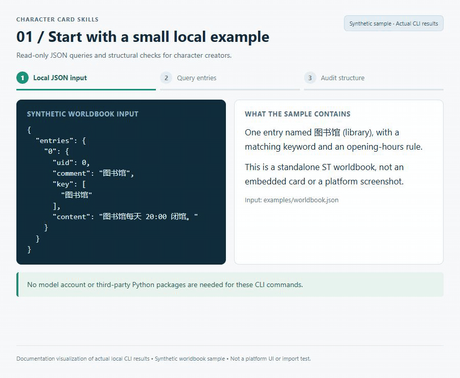
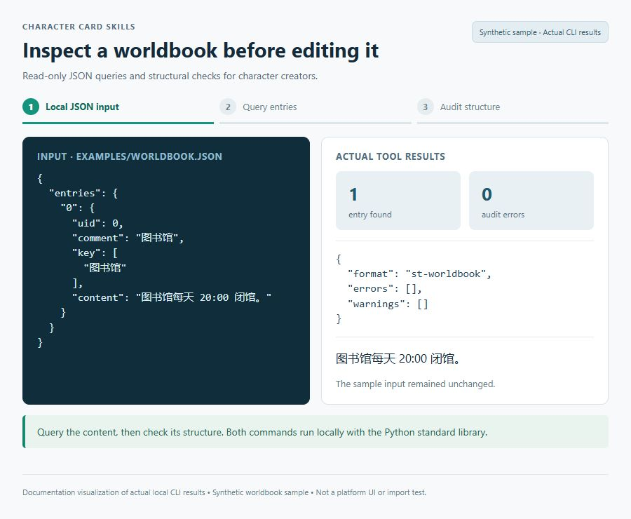

[English quick start](README.en.md) · **简体中文**

# Character Card Skills

面向 **SillyTavern 与 BrainDance/taberna** 的中文角色卡创作技能：从人物、开场白到世界书、状态与记忆，配套本地 JSON 查询和只读结构审计工具。支持校园及其他题材。

**English:** Chinese-language agent skills for authoring and revising SillyTavern and BrainDance/taberna character cards and world books (lorebooks). Includes writing guides, local JSON queries, and read-only structural audits using the Python standard library.

[先试一次](#先试一次无需模型账户) · [安装](#安装) · [使用示例](#使用示例) · [参考指南](#参考指南) · [反馈](#问题反馈与贡献)

- [campus-card-skill](skills/campus-card-skill/SKILL.md)：创作主入口，涵盖人物、开场、世界书、状态和记忆，支持校园及其他题材。
- [world-book-skill](skills/world-book-skill/SKILL.md)：ST 兼容入口，复用主技能的指南。

适合已有角色卡、需要整理世界书或希望按约束改稿的创作者。写作由支持技能的代理完成；本仓库不是聊天客户端，CLI 也不会自动生成角色卡。

## 看看输入与输出

使用仓库内的合成世界书运行实际查询和审计工具，得到下面的结果。图片与动画将 CLI 数据整理成便于阅读的文档展示，不是 SillyTavern 或 taberna 的界面。



<a href="docs/media/worldbook-overview.jpg"></a>

[查看静态全图](docs/media/worldbook-overview.jpg) · [样例文件](examples/worldbook.json)。下方命令可复现这些数据，检查前后文件哈希一致；静态检查不代表平台导入或触发测试通过。

## 先试一次，无需模型账户

准备 Git 和 Python（验证环境为 Python 3.12），在终端执行：

```sh
git clone https://github.com/Marco0431/character-card-skills.git
cd character-card-skills
python skills/campus-card-skill/scripts/query.py examples/worldbook.json --brief
python skills/campus-card-skill/scripts/card-audit.py examples/worldbook.json
```

第一条 Python 命令应返回 `total_entries: 1` 和“图书馆”条目；第二条应返回 `format: "st-worldbook"`、空的 `errors` 列表及条目统计。两者都只读，原文件保持不变，无需安装第三方 Python 包。

[演示 JSON](examples/worldbook.json)是最小合成世界书，不是完整角色卡，也不代表已在目标平台完成导入或长聊测试。试跑成功后，将命令中的路径换成你自己的 JSON。`query.py` 用于独立 ST 世界书；角色卡或 taberna 包装结构请先用 `card-audit.py`。

## 安装

将 `skills/` 下的两个目录一起复制到目标工具的技能目录，保持同级；项目内可放入 `.agents/skills/`。这两项是项目技能，只有文件所在的项目环境才能使用该安装。仓库中的 `skills/` 是分发目录，上传 GitHub 本身不会将技能安装到其他项目。

使用 `$campus-card-skill` 或 `$world-book-skill` 并说明目标卡文件和需求。所有 Python 工具只依赖标准库；验证环境为 Python 3.12。

安装后的项目结构应保留两个目录及其内部文件：

```text
your-project/
└── .agents/skills/
    ├── campus-card-skill/
    │   ├── SKILL.md
    │   ├── references/
    │   └── scripts/
    └── world-book-skill/
        ├── SKILL.md
        └── scripts/
```

复制完后，在该项目中让代理确认能找到两个技能。如果工具使用其他技能目录，按该工具的规则安装，并保持这两个文件夹同级；不要仅复制 `SKILL.md`，因为入口引用了同级指南和脚本。只运行上面的 CLI 不需要安装技能。

## 使用示例

在支持这些技能的代理环境中，指定自己的卡文件与改动范围：

```text
使用 $campus-card-skill 检查 ./card.json 的人物动机与开场白。
先指出不一致之处，再按我的要求修改，保留其他字段和条目 ID。
```

也可以直接从仓库根目录运行 CLI，无需模型或 API 密钥。`card.json` 与 `worldbook.json` 为你提供的本地文件：

```sh
# 检查 ST / taberna 角色卡或独立 ST 世界书的结构
python skills/campus-card-skill/scripts/card-audit.py card.json

# 查看独立 ST 世界书的条目概览或搜索指定内容
python skills/campus-card-skill/scripts/query.py worldbook.json --brief
python skills/campus-card-skill/scripts/query.py worldbook.json --search "图书馆"
```

想先验证查询工具，可将以下**最小演示数据**保存为 `worldbook.json`，然后运行上面的 `--brief` 命令。这只是一个世界书条目，不是完整角色卡，也不是平台导入效果展示：

```json
{
  "entries": {
    "0": {
      "uid": 0,
      "comment": "图书馆",
      "key": ["图书馆"],
      "content": "图书馆每天 20:00 闭馆。"
    }
  }
}
```

审计只检查本地数据结构与部分内容特征；通过不等于平台导入成功、触发行为正确或长聊稳定。

## 遇到问题时

| 现象 | 先检查 |
| --- | --- |
| 代理找不到技能或参考文件 | 是否在安装技能的项目中；两个技能是否同级；是否复制了完整目录 |
| 查询结果为空，但卡内有世界书 | `query.py` 需要独立 ST 世界书的 `entries` 映射，不直接读取卡内嵌套的世界书 |
| 审计提示不支持的结构 | 输入是否为 JSON；支持 ST v2/v3、taberna 与独立 ST 世界书，不从 PNG 角色卡提取数据 |
| 审计没有错误，平台里仍不生效 | 继续检查平台导入、触发词、预算和实际对话；静态审计不执行这些行为 |

代理写作时会接触你提供的卡片内容，数据处理方式取决于所用代理和模型服务；本地 CLI 的只读、不联网范围见 [SECURITY.md](SECURITY.md)。

## 参考指南

| 任务 | 入口 |
|---|---|
| 人设、开场与互动场景 | [创作流程](skills/campus-card-skill/references/writing-guide.md) · [角色与开场](skills/campus-card-skill/references/character-card-guide.md) |
| 世界书、触发、递归与预算 | [ST 配置指南](skills/campus-card-skill/references/config-guide.md) |
| 关系变化与长聊延续 | [状态与记忆](skills/campus-card-skill/references/state-and-memory-guide.md) |
| BrainDance/taberna 格式与迁移 | [格式指南](skills/campus-card-skill/references/taberna-format-guide.md) |
| 交付前检查与平台试跑 | [验证方法](skills/campus-card-skill/references/validation-guide.md) |

## 能力与边界

可以创作、改稿和组织 JSON；附带 CLI 只读取用户指定的 JSON，不自动修改文件、不联网、不执行卡内代码。输入限制为 8 MiB。查询会展示卡内内容，分享结果前应检查隐私。

发布版已移除远程 JavaScript、MVU/EJS/动态 HTML 示例、旧自动生成和写入工具，以及绕过安全约束的旧提示。引导页采用纯文本或 Markdown，不提供脚本按钮和动态面板。

## 验证

在仓库根目录运行：

```sh
python -m unittest discover -s skills/campus-card-skill/scripts -p "test_*.py"
python -m unittest discover -s tests -p "test_*.py"
```

范围和限制见 [SECURITY.md](SECURITY.md)。不包含私人角色作品、凭据、本机绝对路径或原项目提交历史。

## 问题反馈与贡献

[报告问题](https://github.com/Marco0431/character-card-skills/issues/new?template=bug_report.md)时，请注明目标平台、输入格式、Python 版本、命令和预期结果，优先使用上方合成示例复现。公开附件前移除私人角色设定、聊天内容和凭据。

欢迎提交最小格式兼容案例、术语/文档修正，以及可复现的只读工具问题。工具变更可用上方两组测试验证；创作指南变更请说明具体解决了什么写作或使用问题。更多入口见 [文档索引](llms.txt)。

## 许可状态

仓库目前未附带 `LICENSE`，不表示授予任意再分发或商业使用许可；相关使用请先与作者确认。
